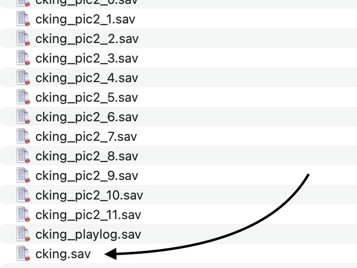

# Wind Waker HD Save Editor

A browser-based editor for renaming quest logs and/or switching them between first and second playthroughs (Hero's clothes) in **The Legend of Zelda: The Wind Waker HD** save files (`cking.sav`) for Wii U / Cemu.

**ONLINE DEMO: [wwhd-editor.nels.app](https://wwhd-editor.nels.app/)**

***No registration or repo download required***. 
Just visit the URL, upload your `cking.sav` file, download the new one, backup your old one, and replace with the new one. 

## Use

1. Open the [online editor](https://wwhd-editor.nels.app/) or open [`index.html`](./index.html) in a modern browser.
2. Locate the game's save folder and choose **`cking.sav`**. Do not choose one of the similarly named `cking_pic2_*.sav` files or `cking_playlog.sav`.

   

3. Drop `cking.sav` onto the editor, or click the file chooser and select it. The editor runs locally in your browser; the save is not uploaded.
4. Edit the names and playthrough settings for the three quest logs, plus health, rupees, magic, and arrow/bomb counts. Expand **Sea chart locations** to mark islands visited or charted individually, or use the bulk actions. Names must be 1-8 printable ASCII characters.

5. Click **Download edited cking.sav** to save the modified copy.
6. Keep a backup of the original. Close the game or emulator, replace `cking.sav` in the game's save folder with the downloaded file, then reopen the game.

No installation or packages are required. The editor runs locally in your browser; save data is not uploaded. To host the app, serve `index.html` and `wwhd-save.js` together from the same directory.
Run the save-format tests with `node --test wwhd-save.test.js`.

## Safety and limitations

- The original file is not changed; edits are downloaded as a separate copy. Keep a backup before replacing your game save. No warranty or support is implied. 
- The editor checks the save's size and checksums before loading, and recalculates checksums for the edited file.
- Sea chart editing covers the 49 island visit flags and their chart-completion flags. It does not add chart items to inventory or edit story, dungeon, pictograph, or playlog data.
- Second-playthrough support changes the clear-count flag only. It has not been tested with every save, so try it on a backup first.
- Save-field layout references: [ZeldaWWHDRecomp save tools](https://github.com/ZeldaWWHDRecomp/ZeldaWWHDRecomp/tree/main/tools/savegame).
- This is an unofficial fan tool and is not affiliated with Nintendo.

## Files

- [`index.html`](./index.html) - browser interface and editing workflow.
- [`wwhd-save.js`](./wwhd-save.js) - save parsing, validation, quest-log and gameplay-field editing, and checksum logic.
